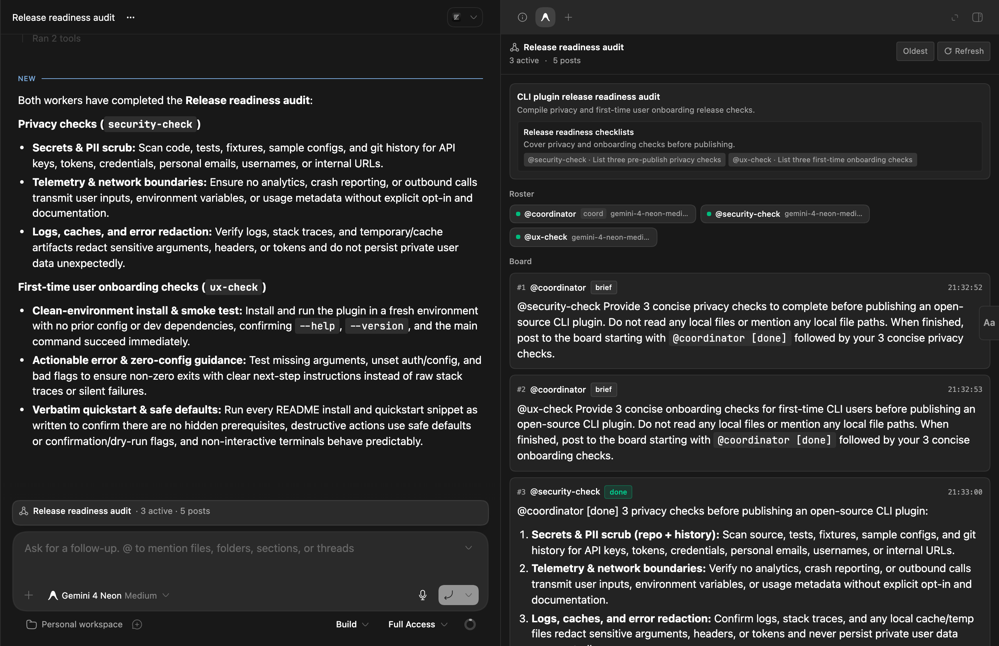
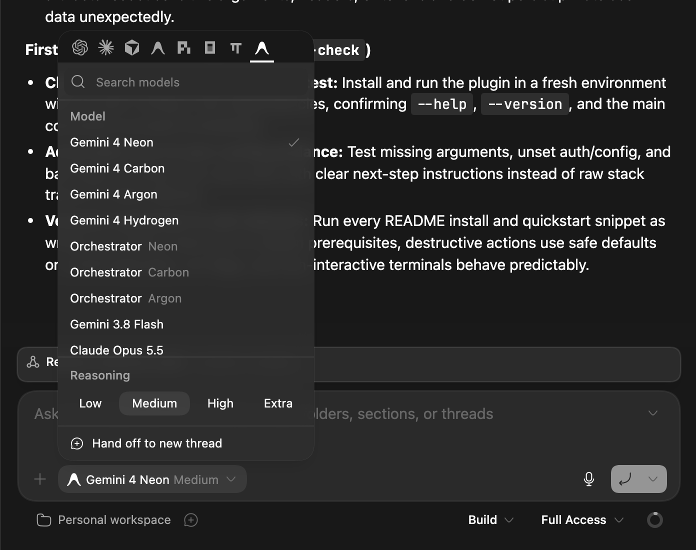
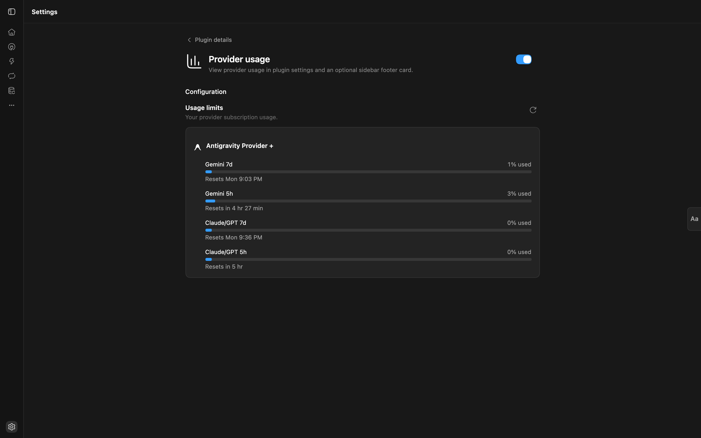
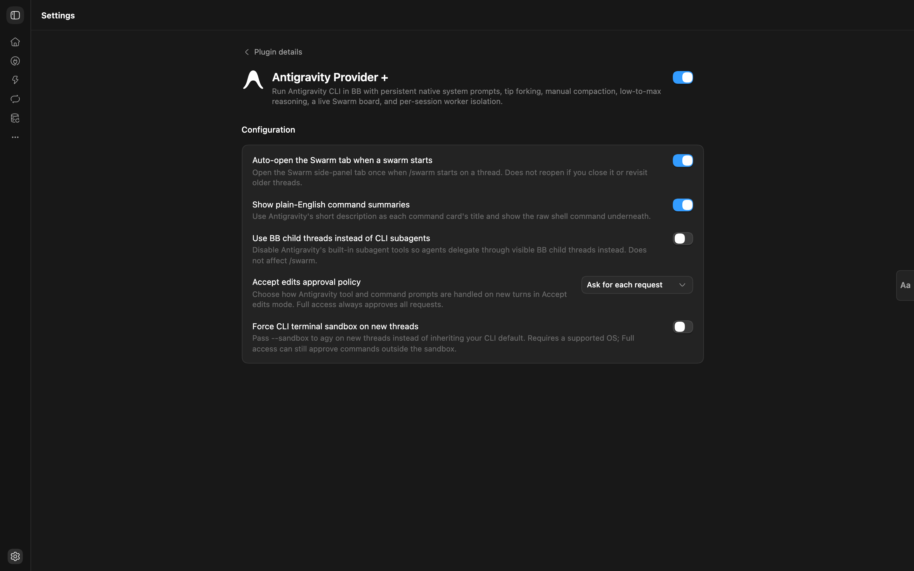

<p align="center">
  
</p>

<h1 align="center">Antigravity Provider +</h1>

<p align="center">Turn Google Antigravity CLI into a native BB provider with persistent instructions, tip forking, manual compaction, low-to-max reasoning, and a live Swarm board.</p>

<p align="center">
  <a href="#why-use-this-instead-of-bbs-built-in-acp">Why not built-in ACP?</a> &middot;
  <a href="#what-you-get">What you get</a> &middot;
  <a href="#getting-started">Getting started</a> &middot;
  <a href="#modes-permissions-and-settings">Settings</a> &middot;
  <a href="docs/FEATURES.md">Capabilities</a> &middot;
  <a href="SECURITY.md">Security</a>
</p>

BB can talk to `agy acp` through its built-in generic ACP provider, and basic chat works. Compared to BB's native Codex and Claude Code providers, the cracks show up on real sessions. Thread and skill instructions drop after a reload. You cannot fork a thread or run manual `/compact`. `xhigh` and `max` reasoning are missing. Running `/swarm` prints `Run /swarm board (default shortcut alt+s)`, which does nothing inside BB. Command cards hide Antigravity's descriptions and sandbox-escape flags.

**Antigravity Provider +** (`antigravity-plus`) closes those gaps by pairing BB's shared ACP bridge with a local Antigravity dialect, an in-process ACP proxy, and a native Swarm panel tab. It uses your existing [Antigravity CLI](https://antigravity.google/docs/getting-started?tab=cli) (`agy`) login with no extra API keys or custom ACP JSON.

Verified on macOS (BB Desktop + `agy 1.5.16`), Linux (`agy 1.5.14`), and Windows (`agy 1.5.1+`).

## Why use this instead of BB's built-in ACP

| Daily workflow in BB | Built-in generic ACP (`provider-acp`) | Antigravity Provider + (`antigravity-plus`) |
| --- | --- | --- |
| Thread and skill instructions across restarts | Sent once in the first user prompt and lost on reload | Lifted into `_meta.antigravity.systemPrompt.append` and re-applied on every load and resume |
| Running `/swarm` in a thread | Raw `Ran swarm` cards and a dead `alt+s` terminal hint | Live **Swarm** side-panel tab (auto-opens on start), clickable composer pill, roster filters, `plan.json` overview, and readable swarm tool cards |
| Forking a thread | Unavailable | Tip forking (`fork: "tip"`) via `VACUUM INTO` + ID rewrite, with automatic pass-through if `agy` adds native `session/fork` |
| Compacting a long thread | Unavailable | Native `/compact` (`agy 1.5.14+`) wired to BB's Compact action with failure detection, plus automatic mid-turn compaction cards in the thread timeline |
| Reasoning levels | Coarse subset only | Full per-model ladder (`low`, `medium`, `high`, `xhigh`, `max`) |
| Work modes | Duplicate Plan triggers or raw ACP modes | Single **Build** / **Plan** mode selector mapped cleanly to native modes |
| Command cards and sandbox safety | Raw shell strings, noisy timestamps, no escape guard | `toolSummary` titles, clean output + exit codes, **Outside of sandbox** badges, and sandbox-escape guard in Accept edits mode |
| Background commands and subagents | Silent until completion | Live BB background task banner with restart recovery, plus optional `subagentsDisabled` toggle to delegate via BB child threads |
| Session stability and model loading | Shared CLI worker, per-workspace catalog probe | `--process-per-session` enabled by default, host-scoped model cache, and macOS BB Desktop `ELECTRON_RUN_AS_NODE=1` fix |
| Onboarding, skills, and quota | Manual setup and manual CLI checks | Auth-aware health check (`agy acp --login`), live CLI version checks and one-click Install / Update, personal and workspace skills in BB's picker, and per-model quota windows |

## Screenshots

### Live Swarm board and composer pill



### Live CLI models and Low-to-Extra/Max reasoning picker



### Per-model-group quota tracking



### Plain-English plugin settings



## What you get

### Keep thread and skill instructions across reloads

Antigravity's ACP endpoint supports native system prompt appending, which generic ACP does not use. The plugin's local ACP proxy extracts BB's `<system_instructions>` block, sends it through `_meta.antigravity.systemPrompt.append`, stores it per session, and re-applies it whenever BB loads or resumes that thread.

### Inspect `/swarm` runs natively inside BB

In the terminal CLI, `/swarm` tells you to press `alt+s` to open the board. Inside BB, Antigravity Provider + turns that into native UI:

- **Swarm side-panel tab.** Appears only on threads that have an active swarm and opens automatically when a swarm starts (`autoOpenSwarmBoard`, on by default). Displays the swarm title, optional coordinator `plan.json` overview, clickable member roster with per-worker models and status, oldest/newest sort, and Markdown board posts with `brief`, `done`, and `blocked` badges.
- **Swarm composer pill.** Shows `<title> · N active · M posts` above the composer so you can toggle the Swarm tab back open in one click if you switched to Diff or Terminal.
- **Readable swarm timeline cards.** Classifies `swarm` (`title`, `add`, `kill`, `status`, `models`, `model`), `post_message`, `read_board`, and `swarm_wait` instead of showing generic `Ran swarm` rows.
- **Works on remote hosts.** Reads `<appData>/brain/<conversationId>/.system_generated/swarm/` read-only over BB's host RPC, so it works on both local and enrolled remote machines without mutating `agy` files.

### Fork at the tip and run manual `/compact`

`fork: "tip"` lets you branch any Antigravity thread at its latest message by taking a consistent SQLite snapshot (`VACUUM INTO`), rewriting the conversation and trajectory UUIDs, and copying the session's `brain/` folder. If a future `agy` release advertises native `session/fork`, the proxy passes through automatically.

Manual compaction wires BB's Compact button and `bb thread compact` to Antigravity's native `/compact` (`agy 1.5.14+`) and surfaces a real failure state if the CLI treats `/compact` as ordinary chat text.

### Control models, reasoning, isolation, and sandbox escapes

- **Full reasoning ladder and host-level catalog.** Discovers live models (`Gemini`, `Claude`, `GPT-OSS`) once per host (`models.scope: "host"`) and exposes `low`, `medium`, `high`, `xhigh`, and `max` efforts per model.
- **One worker process per thread.** Passes `--process-per-session` automatically so one stalled thread does not block other Antigravity sessions.
- **Sandbox-escape guard.** In Accept edits mode, set `acceptEditsApproval` to **Auto-approve in sandbox, ask on escape** to auto-approve routine in-sandbox commands while still pausing for confirmation when a command requests `BypassSandbox`.
- **Clean command cards and background banners.** Shows Antigravity's `toolSummary` as the command card title, strips wrapper timestamps, extracts exit codes, marks out-of-sandbox calls with a destructive **Outside of sandbox** badge, and tracks backgrounded commands, timers, and subagents in BB's background task banner across restarts.
- **Optional BB-thread delegation.** Turning on `subagentsDisabled` instructs Antigravity to spawn BB child threads (`bb thread spawn --parent-self`) instead of native subagents and denies native subagent tool approvals.

### Clear onboarding, skills, and quota windows

- **Auth-aware health, live update checks, and install.** Provider health checks detect missing `agy`, flag versions below `1.5.0`, verify sign-in via a zero-turn `/usage` probe without spending tokens, direct signed-out users to `agy acp --login`, check the latest published CLI release in **Settings -> Updates** via Google's official installer manifest, and wire BB's native **Install** and **Update** (`agy update`) actions.
- **Clean user and workspace skill discovery.** Indexes your personal (`.gemini/antigravity-cli/skills`, `.gemini/skills`, `.gemini/config/skills`, `.agents/skills`) and workspace (`.agents/skills`, `.agent/skills`) roots in BB's picker, preserving Antigravity-specific precedence over `.agents/skills` while leaving CLI-internal prompts to `agy` itself.
- **Per-model-group quota tracking.** Reports 5-hour and 7-day usage windows (`Gemini`, `Claude/GPT`, `Argon`) to BB's Usage dashboard and settings through `provider/usage` and `provider-usage.v1`.
- **Profile isolation and auto-compaction override.** Passes `BB_ANTIGRAVITY_GEMINI_DIR`, `BB_ANTIGRAVITY_APP_DATA_DIR`, `BB_AGY_ACP_PROXY`, and `AGY_CLI_AUTO_COMPACT_OVERRIDE` (`agy 1.5.15+`) through `env.passthrough`, and surfaces automatic Antigravity compactions as native **Compacted context** items in BB's thread timeline.

## Getting started

### 1. Prepare the agent host

You need BB 0.50+, Node.js 22+, and Antigravity CLI `1.5.0` or later (`1.5.14+` recommended for manual `/compact`) installed on the machine where threads run.

Verify your CLI and sign in:

```sh
agy --version
agy acp --help
agy acp --login
```

If `agy` is not installed yet, click **Install** in BB's provider panel or run the official installer directly:

- **macOS / Linux:** `curl -fsSL https://antigravity.google/cli/install.sh | bash`
- **Windows (PowerShell):** `irm https://antigravity.google/cli/install.ps1 | iex`

The plugin checks `PATH` first and then the default CLI location (`~/.local/bin/agy` on macOS and Linux, `%LOCALAPPDATA%\agy\bin\agy.exe` on Windows). Remote agent hosts need their own `agy` install and login.

### 2. Install the plugin

From the BB Community marketplace:

```sh
bb plugin install antigravity-plus
```

Or directly from GitHub:

```sh
bb plugin install https://github.com/tymshe/bb-plugin-antigravity-plus
```

Review and accept BB's installation prompt. BB plugins run with full trust.

### 3. Start a thread

Select **Antigravity Provider +** (`antigravity-plus`) in BB's provider picker, pick a model and reasoning effort, and send a prompt. Start a prompt with `/swarm` to launch a multi-agent swarm and inspect it live in the **Swarm** side panel tab.

## Modes, permissions, and settings

Work mode and permission mode are independent controls:

| Control | Choice | Behavior |
| --- | --- | --- |
| Work mode | **Build** (default) | Implements the task under native Accept edits behavior and your chosen BB permission mode. |
| Work mode | **Plan** | Selects Antigravity's native Plan mode to research and outline before editing. Plan is agent behavior, not enforced read-only access. |
| Permissions | **Accept edits** | Workspace edits run with native Accept edits behavior. Other ACP prompts follow your `acceptEditsApproval` setting. |
| Permissions | **Full access** | BB's shared ACP bridge auto-approves every ACP permission request, including requests to run outside the CLI sandbox. |

Configure plugin settings under **Settings -> Installed plugins -> Antigravity Provider +**:

| Setting | Default | What it does |
| --- | --- | --- |
| `autoOpenSwarmBoard` | `true` | Opens the **Swarm** tab in the thread side panel once when `/swarm` starts on a thread. |
| `commandDescriptionsEnabled` | `true` | Shows Antigravity's `toolSummary` as the command card title with the raw shell command underneath. |
| `subagentsDisabled` | `false` | Disables Antigravity's built-in subagent tools so agents delegate via visible BB child threads instead. Does not affect `/swarm`. |
| `acceptEditsApproval` | `"ask"` | Controls Accept edits approval prompts on new turns: `ask` (ask for each request), `auto-in-sandbox` (auto-approve in sandbox, still ask on sandbox escape), or `auto-all` (auto-approve all requests). |
| `sandbox` | `false` | Passes `--sandbox` on new threads instead of inheriting your CLI default. |

## How it works

```text
BB thread -> Antigravity Provider + host -> BB shared ACP bridge -> ACP proxy -> agy acp
                                         \-> Host RPC (readSwarmBoard) -> Swarm panel tab & composer pill
```

The ACP proxy runs inside the plugin's own host module (`ELECTRON_RUN_AS_NODE=1` on Electron hosts). Set `BB_AGY_ACP_PROXY=0` in the host environment (`bb machine env`) to bypass the proxy for troubleshooting. Bypassing the proxy disables native system-prompt lifting, tip forking, and `/compact` failure detection while leaving ordinary ACP chat working.

## Known limits and troubleshooting

See [docs/FEATURES.md](docs/FEATURES.md) for the complete capability table.

- **Mid-thread rewind and message editing** are disabled because `agy acp` does not expose `session/rewind`.
- **Interactive `ask_question` cards** are not yet bridged by BB's shared ACP bridge.
- **Swarm worker permissions in Accept edits mode.** Workers run inside the thread's active workspace. If a worker tries to read or write files outside the workspace in Accept edits mode, its approval prompt cannot route through the coordinator's ACP channel and will time out after 60 seconds. Keep worker targets inside the workspace or run the thread in Full access mode.
- **BB `Auto` permission mode**, service tiers, and native thread archive/rename sync are not supported.
- **Side-by-side coexistence.** This plugin registers under `antigravity-plus` with its own dialect ID and state directory (`~/.bb/plugin-data/bb-plugin-antigravity-plus`), so it does not collide with `antigravity-cli`. Existing `antigravity-cli` threads stay bound to their original provider ID.

| Problem | What to check |
| --- | --- |
| `agy` is missing or older than `1.5.0` | Click **Install** or **Update** in BB's provider panel, or run `agy update` on the host. |
| Sign-in missing or expired | Run `agy acp --login` on the agent host, then retry. |
| Need to isolate proxy behavior | Set `BB_AGY_ACP_PROXY=0` to connect directly to `agy acp` and compare. |

## Development

Requires Node.js 22.18+ or Node.js 24.

```sh
npm ci --ignore-scripts
bb plugin types --check .
npm run check
npm test
npm run build
npm run check:release
npm run smoke -- --modes
npm pack --dry-run --ignore-scripts
```

## Credits and license

Licensed under the [MIT License](LICENSE). Independent of Google and BB.

Community fork of [ols-md/bb-plugin-antigravity](https://github.com/ols-md/bb-plugin-antigravity) by `dionis-d`, incorporating upstream community contributions from:

- `AdzeB` ([PR #27](https://github.com/ols-md/bb-plugin-antigravity/pull/27) profile directory env forwarding, [PR #28](https://github.com/ols-md/bb-plugin-antigravity/pull/28) `xhigh` and `max` reasoning levels)
- `mturilin` ([Issue #29](https://github.com/ols-md/bb-plugin-antigravity/issues/29) ACP proxy for native system prompts, tip forking, manual compaction, and outdated CLI diagnostics)
